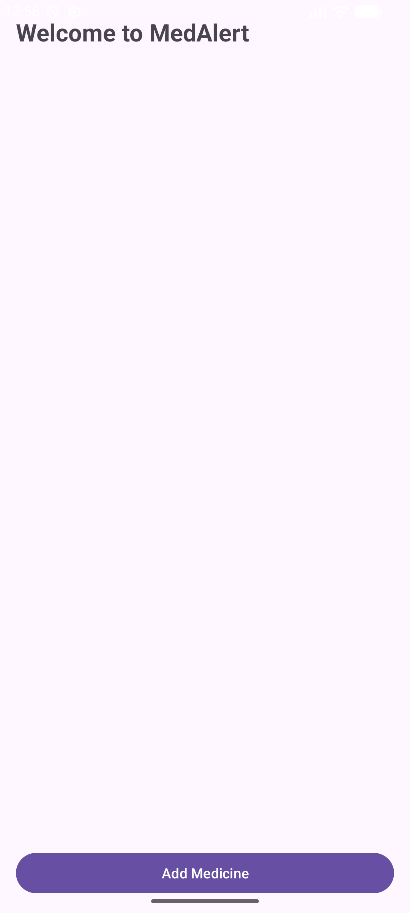

# Lab Test 1: MedAlert - Medicine Reminder Application

## 📱 Project Overview

**MedAlert** is an Android application developed in Kotlin designed to help users track their medication schedules and receive timely reminders. 

The application demonstrates core Android development concepts including **Activity and Fragment Lifecycles**, **RecyclerView & Adapters**, **ViewBinding**, **Explicit Intents for Activity navigation and data passing**, and **Android Notification Channels**.

---

## 🎯 Aim & Objectives

* Develop an Android application using **Kotlin** for managing and tracking medications.
* Demonstrate **Activity & Fragment Lifecycle** logging.
* Implement dynamic list rendering using **RecyclerView** with **CardView** items.
* Implement data transfer between Fragments and Activities using **Fragment Result API** and **Explicit Intents** (`Serializable`).
* Integrate **Android Notifications** with **Notification Channels** for reminder alerts.

---

## 🔄 Application Architecture & Flow

```text
               MainActivity (Dashboard)
                   │
                   ├──► Click "Add Medicine"
                   │          │
                   │          ▼
                   │    AddMedicineFragment (Form)
                   │    - Medicine Name & Dosage
                   │    - Type (Tablet, Syrup, Capsule)
                   │    - Frequency (Once, Twice, Thrice)
                   │    - Reminder Notification Toggle
                   │          │
                   │          ├──► Save Medicine
                   │          │    ├── Set Notification (if enabled)
                   │          │    └── FragmentResult -> MainActivity
                   │          ▼
                   ├──► Update RecyclerView List
                   │
                   └──► Click on any Medicine Item
                              │
                              ▼
                        MedicineDetailsActivity
                        - Detailed Medicine Information
                        - Back Button to Dashboard
```

---

## ✨ Features

* 📋 **Dashboard View**: Displays the list of registered medicines with dosage and schedule.
* ➕ **Add Medicine Fragment**: Interactive form with input validation, RadioGroups, and Reminder Checkbox.
* 🔔 **Instant Notifications**: Automated notification alerts on reminder enablement using `NotificationCompat` and `NotificationChannel`.
* 📄 **Medicine Details Activity**: Detailed inspection screen for each medicine item.
* 🔄 **Full Lifecycle Logging**: Tracks all lifecycle callbacks (`onCreate`, `onStart`, `onResume`, `onPause`, `onStop`, `onDestroy`, `onRestart`, `onAttach`, `onCreateView`, `onViewCreated`, `onDestroyView`, `onDetach`).
* 🎨 **Material 3 Design**: Clean, modern card-based user interface.

---

## 🛠️ Technologies Used

| Component / Library | Purpose |
| :--- | :--- |
| **Kotlin** | Application Logic & Data Classes |
| **Android Jetpack ViewBinding** | Safe View referencing |
| **RecyclerView & CardView** | Dynamic medicine list rendering |
| **Fragments & FragmentResultListener** | Modular screen components and data exchange |
| **Explicit Intents & Serializable** | Navigation and data passing to details screen |
| **NotificationManager & NotificationChannel** | Reminder notifications (Android 8.0+ compatible) |
| **Material Components (M3)** | Modern UI widgets and styling |

---

## 📂 Project Structure

```text
Lab_Test_1/
├── app/
│   ├── src/
│   │   └── main/
│   │       ├── java/com/example/medalert_medicinereminder/
│   │       │   ├── MainActivity.kt
│   │       │   ├── AddMedicineFragment.kt
│   │       │   ├── MedicineDetailsActivity.kt
│   │       │   ├── Medicine.kt
│   │       │   └── MedicineAdapter.kt
│   │       ├── res/
│   │       │   ├── layout/
│   │       │   │   ├── activity_main.xml
│   │       │   │   ├── activity_medicine_details.xml
│   │       │   │   ├── fragment_add_medicine.xml
│   │       │   │   └── item_medicine.xml
│   │       │   └── values/
│   │       │       ├── strings.xml
│   │       │       ├── colors.xml
│   │       │       └── themes.xml
│   │       └── AndroidManifest.xml
│   └── build.gradle.kts
├── gradle/
├── screenshots/
├── build.gradle.kts
├── settings.gradle.kts
└── README.md
```

---

## 🖥️ User Interface Screenshots

| Welcome / Dashboard Screen |
| :---: |
|  |

---

## 👨‍💻 Author

* **Repository:** [Android-Studio](https://github.com/syedfa612/Android-Studio)
